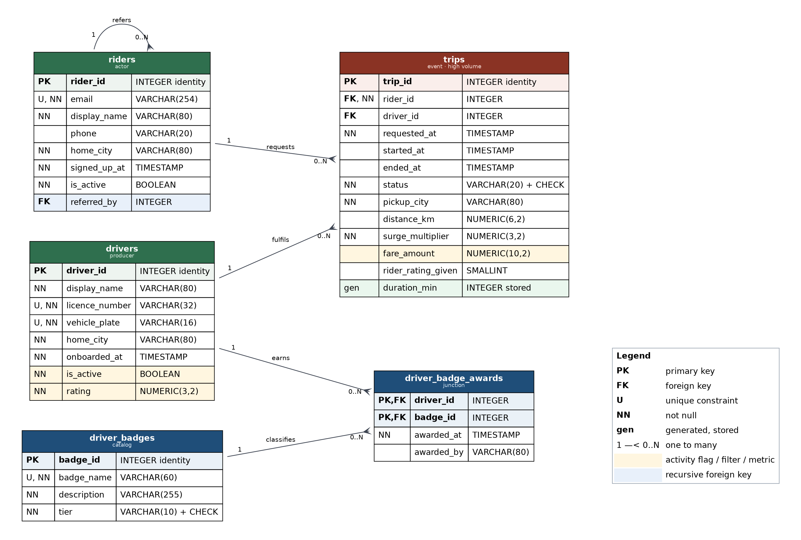

# Ride Sharing Platform — Database Design and Analysis

**A six-unit SQL project that starts with a relational design and ends by auditing a reported
statistic that was wrong by a factor of seven.**

**Author:** Freddy Mok Ho
**Course:** EX 603 — Course Project, Units 1–6
**Theme:** 1 — Ride Sharing
**Status:** Complete

---

## The domain

The system models a ride sharing marketplace: an application that matches people who want to
travel with drivers willing to carry them, prices each journey, and records the result. Two
populations meet on the platform. **Riders** open the app and request a trip. **Drivers** are
the supply side — vetted, licensed, each associated with one vehicle, each carrying a rolling
quality rating and a flag indicating whether they are currently permitted to accept work.
Every request either becomes a completed journey or is cancelled, and either way it is
recorded as a row in **trips**, the high-volume table at the centre of the system.

Alongside the marketplace runs a driver rewards programme. **Driver badges** form a small
catalogue of achievements — "Night Owl", "Safe Driving", "Airport Pro" — that drivers earn
over time. A driver may hold many badges and a badge may be held by many drivers, so the
relationship is many-to-many and is resolved through the **driver badge awards** junction,
whose composite primary key makes it impossible to award the same badge twice.

The analysis exists to answer questions the business actually asks, and the project is
structured around one that went wrong. A dashboard reported that roughly half of all trips
ended in a rider no-show. A quarterly driver bonus pool was frozen on the strength of it.
Nobody had read the query. Units 3 to 6 work through the consequences: what the true rate is,
which drivers contribute to it, who the analysis cannot see, and whether it is improving.
The answers are 6%, two drivers, two more drivers who never appear in any report, and
*we cannot tell yet* — and each one took a query to establish and a check to believe.

---

## Database overview



Two databases appear in this repository, and the distinction matters when reading the queries.

**`/schema`** holds my own design from Units 1 and 2 — the ERD above, the relation schemas,
the integrity constraints, and [`schema.sql`](schema/schema.sql), a DDL script that builds it
and runs cleanly twice in a row.

**`ex603_data`** is the course-provided dataset introduced in Unit 3, and it is what every
query from Unit 3 onward runs against. Its structure is close to my design but not identical.
All analysis below refers to this dataset.

The five tables that carry the analysis:

| Table | Role | What it holds |
| --- | --- | --- |
| `riders` | actor | 30 riders. Includes a self-referencing `referred_by` key. |
| `drivers` | producer | 15 drivers, with `is_active` and `avg_rating`. Only 13 ever appear in `trips`. |
| `trips` | event | 200 trips — the fact table. Carries `fare_amount`, timestamps, `trip_status` and a nullable `cancellation_reason`. |
| `driver_badges` | catalog | 5 badges. |
| `driver_badge_awards` | junction | 25 awards, composite-keyed on `(driver_id, badge_id)`. |

Two properties of `trips` drive most of what follows. **`cancellation_reason` is NULL for 166
of 200 rows** — correctly, because a trip that completed was never cancelled — and that single
fact is what broke the original dashboard. And **cancelled trips carry a fare of 0.00**, which
is correct but drags the reported average fare down by 17%.

---

## Query catalogue

Every `.sql` file carries a header stating the task it answers and the question in plain
language. Each runs against `ex603_data` without editing.

### Unit 3 — auditing the disputed figure

| File | Business question |
| --- | --- |
| [`q3_1.sql`](queries/unit3/q3_1.sql) | What is actually in this data? Who are the active, highly-rated drivers; what outcomes can a trip have; how many trips carry no cancellation reason, and why? |
| [`q3_2.sql`](queries/unit3/q3_2.sql) | How did a query that runs without error report 44% when the answer is 6%? Reproduces both bugs and repairs them. |
| [`q3_3.sql`](queries/unit3/q3_3.sql) | Which riders were involved in the disputed trips? Answered three equivalent ways, with proof the results are identical and a demonstration of where that equivalence collapses. |

### Unit 4 — measuring the platform

| File | Business question |
| --- | --- |
| [`q4_1.sql`](queries/unit4/q4_1.sql) | What does the platform look like in aggregate, and how does it vary by driver and region? Baseline statistics, per-driver rates, a volume threshold with `HAVING`, and a two-dimension breakdown. |
| [`q4_2.sql`](queries/unit4/q4_2.sql) | Which drivers drive the failure rate? Conditional aggregation in one pass, regional subtotals with a grand total, and a two-step pipeline establishing a baseline. |

### Unit 5 — joins, and the drivers no aggregate could see

| File | Business question |
| --- | --- |
| [`q5_1.sql`](queries/unit5/q5_1.sql) | Who are the people behind each trip, do the problem drivers share a credential, and how do drivers compare with others in their own city? |
| [`q5_2.sql`](queries/unit5/q5_2.sql) | Which drivers does an inner join silently drop, and how do we find drivers with no trips at all? |
| [`q5_3.sql`](queries/unit5/q5_3.sql) | How does PostgreSQL execute a three-table join, and what would make it choose differently? |

### Unit 6 — is it getting better?

| File | Business question |
| --- | --- |
| [`q6_1.sql`](queries/unit6/q6_1.sql) | Is a trip unusual *for its own driver*, and who should appear higher on a leaderboard when two drivers tie? |
| [`q6_2.sql`](queries/unit6/q6_2.sql) | Is a driver's earning trending up or down, where does the platform stand against its target, and what does a gap in activity mean? |
| [`q6_3.sql`](queries/unit6/q6_3.sql) | What are each driver's best trips, and is the no-show rate improving month over month? |

Written analysis accompanies each unit in [`/analysis`](analysis), and each of Units 3–6 ends
with a memo written for a non-technical reader.

---

## Technical highlights

**1. Three-valued logic, and why `<>` is not the opposite of `=`.**
The original dashboard filtered with `cancellation_reason <> 'Driver unavailable'`, expecting
193 of 200 rows. It returned 27. A comparison against NULL yields UNKNOWN, and `WHERE` keeps
only rows that are TRUE, so the 166 rows with no cancellation reason failed the filter *and*
its apparent opposite. The repair is `IS DISTINCT FROM`. The proof is a single row of output:
27 kept + 7 excluded = 34, against a table of 200. ([`q3_2.sql`](queries/unit3/q3_2.sql))

**2. Conditional aggregation instead of two filtered queries.**
`SUM(CASE WHEN ... THEN 1 ELSE 0 END)` puts the total and the failure count in one pass over
the table, with no `WHERE` to shrink the denominator. The complement column must sum back to
the total, which makes the arithmetic checkable inside the same result set. Two separate
filtered queries have two independent `WHERE` clauses and nothing enforcing that they select
the same population — which is how the original error happened.
([`q4_2.sql`](queries/unit4/q4_2.sql))

**3. Outer joins to find what is absent.**
An inner join from `drivers` to `trips` returns 13 drivers. A left join returns 15. The two
missing drivers are active and have never taken a trip, so they cannot appear in any
per-driver analysis built on the event table — and nothing in an inner join's output discloses
the omission. `NOT EXISTS` and `EXCEPT` both surface them.
([`q5_2.sql`](queries/unit5/q5_2.sql))

**4. Reading an execution plan rather than guessing at it.**
`EXPLAIN` on the three-table join shows two nested Hash Joins over three sequential scans,
despite primary key indexes being available on both dimension tables. Setting
`enable_hashjoin = off` proves the planner considered and rejected them: the Nested Loop
alternative costs 24.18 against 9.29. "Add an index" is not a universal fix, and an unused
index still slows every write. ([`q5_3.sql`](queries/unit5/q5_3.sql))

**5. Window functions to compare a row with its group.**
`AVG(...) OVER (PARTITION BY driver_id)` writes each driver's average onto all 200 trip rows,
so a trip can be compared against its own driver's norm without losing the trip. `GROUP BY`
returns 13 rows and discards 187, after which no per-row question can be asked.
([`q6_1.sql`](queries/unit6/q6_1.sql))

---

## Findings and recommendations

**1. The reported failure rate was wrong by a factor of seven, and the numerator was never
the problem.** The dashboard said ~44%; the true rate is **6.0%** — 12 rider no-shows across
200 trips. There have always been exactly 12. What moved was the denominator, from 193 down
to 27, because a filter silently discarded every trip that was never cancelled.
*Recommendation:* reconcile the parts against the total before acting on any figure. If the
categories on a chart do not sum to the record count, something was discarded.

**2. Two drivers are worth investigating, and two more are worth investigating for the
opposite reason.** Drivers 2 and 3 are the only two with more than one no-show. Drivers 14
and 15 are active, have taken zero trips all year, and appear in no report built from the
trips table. The self join rules out the easy explanations — same cities as busy colleagues,
comparable ratings, comparable tenure. *Recommendation:* read the five trip records for
drivers 2 and 3; phone drivers 14 and 15. Neither is an analytics question any more.

**3. The quarterly trend looks like steady improvement and is not.** Grouped by quarter the
no-show rate falls 7.5% → 6.3% → 5.9% → 4.2%, a 44% annual reduction. It rests on 4, 3, 3 and
2 incidents. **One additional no-show in Q4 takes it to 6.3% — identical to Q2 — and the
decline vanishes.** Sliced monthly, the same data supports the opposite conclusion.
*Recommendation:* do not report a no-show trend or set a target against it. Report the count.

Full memos: [Unit 3](analysis/unit3-finding.md) · [Unit 4](analysis/unit4-finding.md) ·
[Unit 5](analysis/unit5-finding.md) · [Unit 6](analysis/unit6-finding.md)

---

## Limitations and future improvements

**The dataset is a sample, not a complete record, and that limits every conclusion above.**

200 trips across 13 drivers, 5 cities and 365 days is roughly one trip every other day for
the entire platform. No real ride-share operation runs at that volume. The consequence shows
up most clearly in the gap analysis: 9 of 13 drivers have a gap of more than 60 days between
consecutive trips, and the mean gap is 22 days. Read individually, driver 9's 113-day absence
looks like someone who stopped working. Read against the fleet, it is what sparse sampling
looks like. The data cannot distinguish "took no trips" from "took trips that are not in this
extract".

The same sparsity undermines every rate. Twelve no-show incidents is enough to establish a
*level* — 6% is solid, because it rests on all 200 trips — and nowhere near enough to
establish a *direction*. Per-driver rates are built on 1 to 3 events each, and regional rates
on 1 to 4.

**What would fix it:** the complete trip log rather than an extract. With a full year of real
volume, the quarterly comparison would have thousands of events behind each rate instead of
two or three, and a 1.7-point quarterly move would become a question worth asking rather than
one rider's change of plans.

**Two further things I would want**, neither of which is in this database: driver app session
history, which would settle whether drivers 14 and 15 were ever offered work; and the rider
side of each no-show, which would show whether the incidents attributed to drivers 2 and 3
involve one repeat rider or five unrelated ones. Both questions are currently unanswerable
with any query.

**What I would do differently.** I would have written the reconciliation check — do the
category counts sum to the table count — as the first query of Unit 3 rather than discovering
its necessity by debugging. It takes one line and it catches the entire class of error this
project is built around. I would also have tested each `CHECK` constraint in Unit 2 against a
row designed to violate it; one of mine read correctly in English and did not hold in SQL,
and only running it found that out.

---

## Video presentation

**[Watch the 3–5 minute walkthrough](ADD_YOUR_VIDEO_URL_HERE)**

Covers the platform and the business question, two SQL demonstrations including a
window-function query, the key findings, and the sampling limitation above.

---

## How to run it

Assumes PostgreSQL 14 or later and nothing else.

**Build my Unit 1–2 schema** (empty tables, no data):

```bash
createdb ex603_ridesharing
psql -d ex603_ridesharing -f schema/schema.sql
```

The script is idempotent — it drops in reverse creation order before creating, so it runs
repeatedly with no manual cleanup.

**Load the analysis dataset and run the queries:**

```bash
createdb ex603_data
psql -d ex603_data -f rideshare.sql        # course-provided dataset
psql -d ex603_data -c "SELECT COUNT(*) FROM trips;"   # expect 200

psql -d ex603_data -f queries/unit3/q3_1.sql
psql -d ex603_data -f queries/unit3/q3_2.sql   # no ON_ERROR_STOP: one query must fail
psql -d ex603_data -f queries/unit3/q3_3.sql
psql -d ex603_data -f queries/unit4/q4_1.sql
psql -d ex603_data -f queries/unit4/q4_2.sql
psql -d ex603_data -f queries/unit5/q5_1.sql
psql -d ex603_data -f queries/unit5/q5_2.sql
psql -d ex603_data -f queries/unit5/q5_3.sql   # runs ANALYZE; gathers statistics, changes no data
psql -d ex603_data -f queries/unit6/q6_1.sql
psql -d ex603_data -f queries/unit6/q6_2.sql
psql -d ex603_data -f queries/unit6/q6_3.sql
```

Two files behave deliberately unusually. **`q3_2.sql` contains a query that must fail** — the
alias error is the evidence Unit 3 asks for — so do not run it with `-v ON_ERROR_STOP=1`.
**`q5_3.sql` runs `ANALYZE`** to demonstrate how statistics change a query plan; that gathers
statistics and modifies no data, and its `enable_hashjoin` toggle is session-scoped and reset
within the file.

**Regenerate the ERD** (requires [Graphviz](https://graphviz.org/download/)):

```bash
dot -Tpng -Gdpi=140 schema/erd.dot -o schema/erd.png
```

---

## Repository structure

| Path | Contents |
| --- | --- |
| [`/schema`](schema) | Units 1–2: ERD and source, relation schemas, constraint justifications, and the DDL script. |
| [`/queries/unit3`](queries/unit3) … [`unit6`](queries/unit6) | One folder per unit, every file commented with the question it answers. |
| [`/analysis`](analysis) | Written analysis per unit, plus a leadership memo for each of Units 3–6. |
| [`/screenshots`](screenshots) | Execution evidence, named so each maps to the task it supports. |

No credentials, connection strings, or personal data appear anywhere in this repository,
including in screenshots and SQL file headers.
